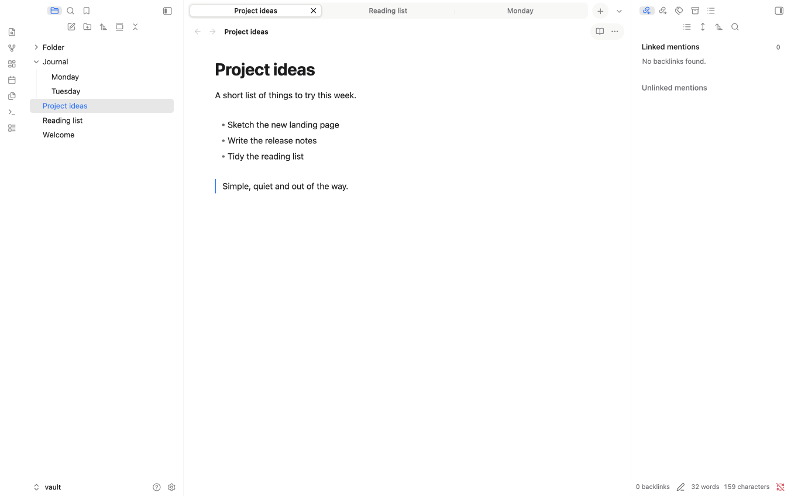
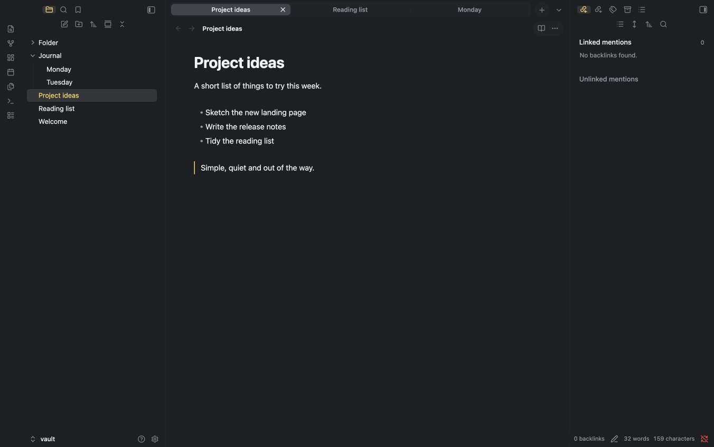

# minilite-flat

A flat, Apple-inspired, minimal Obsidian theme. Both sidebars sit edge to edge with no inset container, separated from the editor by a single hairline.

> **Parent theme:** minilite-flat is a derivative of [minilite](https://github.com/jrayas/minilite) by the same author. It keeps minilite's palette, tab strip and typography, and removes the inset, rounded sidebar panels. If you prefer the panels, use the parent theme.

## What is different from minilite

- No inset, rounded container around the left and right sidebars.
- No margin, border or separate fill on the sidebar panels; they share the editor background.
- A thin divider line on the inner edge of each sidebar.
- Everything else (tab strip, accents, toolbar capsules, file explorer rows) is inherited from minilite.

## Install

1. Copy this folder (`minilite-flat`) into `<Vault>/.obsidian/themes/`.
2. In Obsidian, open Settings → Appearance → Themes and choose **minilite-flat**.

## Light and dark mode

Settings → Appearance → Base color scheme: choose Light, Dark, or Adapt to system.

- **Light:** Finder blue (`#007aff`) accent, milk-white tab strip.
- **Dark:** Notes yellow (`#ffd75e`) accent.

## Accent colours (optional)

Install the *Style Settings* community plugin, then open Settings → Style Settings → minilite. You can choose the default, yellow in both modes, yellow with blue links, blue, green or purple. Without the plugin the default applies.

## Customising

Colours are CSS custom properties at the top of `theme.css`. The side panel (`--ans-side-*`), tabs (`--ans-tab-*`), breadcrumb path (`--ans-crumb-*`) and the reading-mode and three-dots capsule (`--ans-actions-*`) each have their own hover and selected colours.

## Known limitations

- Tested on macOS with Obsidian 1.14.4 only. Windows, Canvas, Graph view and narrow windows have not been checked.
- The divider line between sidebar and editor can be removed by deleting the two `border-left` and `border-right` rules in section 5 of `theme.css`.

## Credits and licence

Based on [minilite](https://github.com/jrayas/minilite). Released under the MIT licence (see `LICENSE`).
